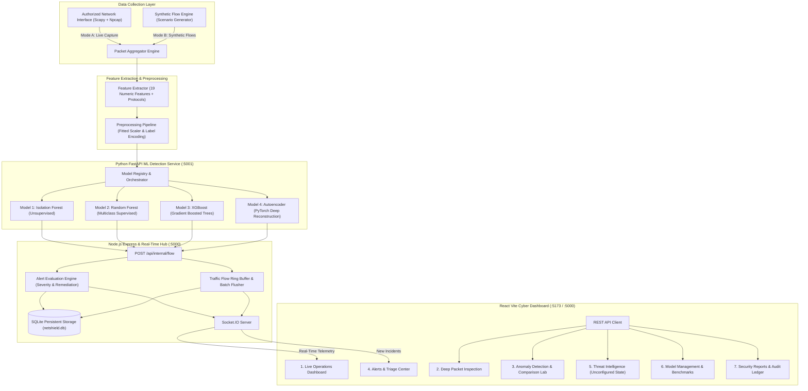

# NetShield AI — Architectural Blueprint

## System Responsibilities & Boundaries

1. **Python ML Engine (`ml-service/`, port 5001)**:
   - Manages packet sniffing via Scapy and psutil adapter enumeration.
   - Houses the multi-scenario traffic generator (`traffic_simulator.py`).
   - Extracts 19 standardized network flow features (conforming to CIC-IDS2017 & UNSW-NB15 schemas).
   - Preprocessing pipeline ensures identical numeric scaling and one-hot protocol alignment across training and live inference.
   - Houses all 4 detection engines: Isolation Forest, Random Forest, XGBoost, and PyTorch Autoencoder.

2. **Node.js Express Coordinator (`server/`, port 5000)**:
   - Coordinates REST APIs, security headers, rate limiting, and client sessions.
   - Evaluates alerts based on anomaly scores, attack categories, and investigation playbooks.
   - Emits bounded, batched WebSocket updates via Socket.IO to avoid UI thread saturation.
   - Native SQLite synchronization using Node.js standard `node:sqlite DatabaseSync`.
   - Serves the compiled React production bundle for single-port deployments.

3. **React Dashboard (`client/`, port 5173 or port 5000)**:
   - Modern, high-contrast dark navy UI (`#060a12`) with cyan (`#06b6d4`) and amber accents.
   - 7 responsive security pages for real-time operations, forensic inspection, comparative lab analysis, alert triage, threat intelligence, model management, and exportable audit reports.

